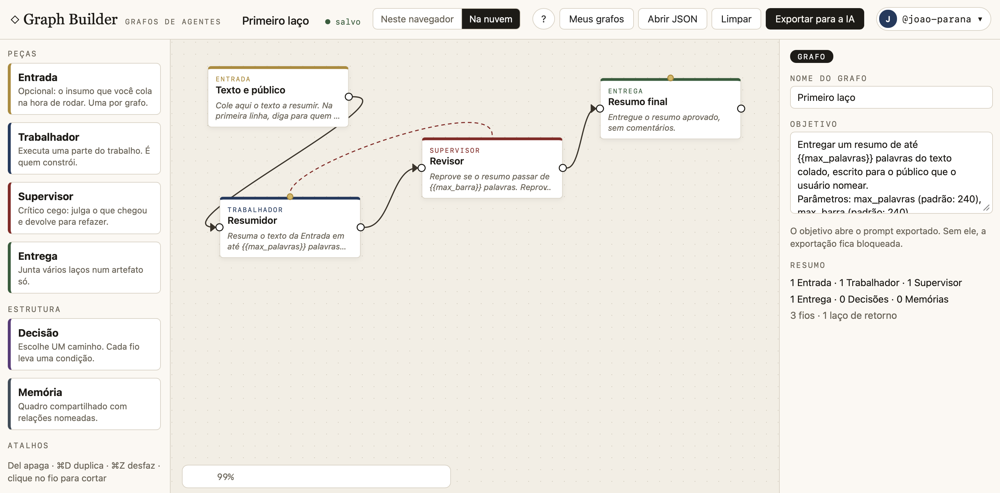

# Tutorial 01 — Primeiro laço

## 1. Objetivo

Montar o menor grafo com um **laço**: um Trabalhador escreve, um Supervisor julga e, se reprovar,
devolve para refazer. 
Este Tutorial descreve o processo de criação de um grafo que resume um texto colado/informado para um público que você nomeia.

Ao terminar, você terá visto:

- as quatro peças do laço: **Entrada → Trabalhador → Supervisor → Entrega**;
- o fio comum (`Flow`), que você desenha, e o **retorno implícito**, que o app desenha sozinho;
- **a barra** do Supervisor e o botão "Público explícito" de "Preencher rápido";
- o painel **"Antes de exportar"** acusando o que falta enquanto o grafo é montado.

### Onde rodar

Use o Graph Builder na web, em <https://joao-parana.github.io/graph-builder/>: não é preciso
instalar nada. No topo, escolha onde os grafos ficam:

- **Neste navegador:** sem conta. Os grafos ficam só neste navegador, neste computador.
- **Na nuvem:** com login. Os grafos ficam na sua conta e abrem em outro computador. Como entrar:
  [Pedir um convite](index.md#entrar-na-nuvem).

O tutorial funciona igual nos dois modos.

#### Atalho importando um Grafo já existente

Se desejar um atalho pulando a parte de edição do grafo de exemplo, baixe [`exemplos/01-primeiro-laco.json`](exemplos/01-primeiro-laco.json), carregue-o usando
**Abrir JSON** e pule para a [seção 5](#5-o-prompt-exportado).

## 2. O grafo




O fio tracejado vermelho do Revisor ao Resumidor é o **retorno implícito** (SPEC §3.3): você não o
desenha nem o seleciona. Ele aparece sozinho quando um Trabalhador liga num Supervisor e chega ao
**ponto dourado** no topo do Trabalhador. A Entrega também tem um ponto dourado, porque também
pode ser construtora; aqui ninguém devolve para ela.

## 3. Passo a passo no editor

Em cada passo, olhe o painel **"Antes de exportar"**. Os **erros** bloqueiam a exportação; os
**alertas** não.

**Passo 1 — Grafo novo.** Em **Meus grafos**, clique em **+ Novo grafo** e, no título do topo, troque "Meu grafo" por
`Primeiro laço`.

> Antes de exportar: **2 erros**
> - O grafo está sem objetivo — escreva, na direita, o que ele precisa entregar. *(VAL-01)*
> - O grafo não tem nenhuma Entrega. *(VAL-07)*

Os dois erros já aparecem com o grafo vazio. Eles são o mínimo para exportar: dizer o que se quer
e ter onde o resultado chegar.

**Passo 2 — Objetivo.** Clique numa área vazia do canvas: o painel da direita mostra o grafo. Em
**Objetivo**, escreva:

```text
Entregar um resumo de até {{max_palavras}} palavras do texto colado, escrito para o público que o usuário nomear.
Parâmetros: max_palavras (padrão: 240), max_barra (padrão: 240).
```

Some o VAL-01. Fica o VAL-07.

> **O que é `{{max_palavras}}`?** Um **parâmetro**: o app copia o marcador como está, e quem executa
> troca pelo valor (na skill `/executar-grafo`, `max_palavras=80`; sem valor, vale o padrão da
> linha `Parâmetros:`). Chave **simples**, como `{público}` no passo 6, é texto comum.

**Passo 3 — Três peças.** Na paleta **Peças**, clique (ou arraste para o canvas) em **Entrada**,
**Trabalhador** e **Supervisor**. Elas nascem como "Entrada 1", "Trabalhador 1" e "Supervisor 1".

> Antes de exportar: **2 erros** e **7 alertas** (o painel mostra os 5 primeiros e "+ 4 outros")
> - "Supervisor 1" não recebe nada para julgar. *(VAL-05)*
> - O grafo não tem nenhuma Entrega. *(VAL-07)*
> - "Entrada 1", "Trabalhador 1" e "Supervisor 1" estão sem instruções. *(VAL-02)*
> - "Supervisor 1" não leva a lugar nenhum (sem saída). *(VAL-06)*
> - As três estão soltas (sem fios). *(VAL-08)*

**Passo 4 — Ligar.** Arraste da bolinha da direita da Entrada até a bolinha da esquerda do
Trabalhador; depois do Trabalhador até o Supervisor. No segundo fio, aparece o tracejado vermelho
do Supervisor de volta ao ponto dourado do Trabalhador: é o laço.

Somem VAL-05 (o Supervisor agora tem o que julgar) e VAL-08. Ficam VAL-07, VAL-06 e os três VAL-02.

**Passo 5 — Entrega.** Ponha uma **Entrega** e ligue o Supervisor nela. Somem VAL-07 e VAL-06:
**não há mais erros**, só os quatro alertas de instruções vazias. Já daria para exportar, mas o
prompt sairia com `_(sem instruções)_` em cada etapa.

**Passo 6 — Nomes e instruções.** Clique em cada peça e preencha **Nome da peça** e
**Instruções**:

- **Entrada** → `Texto e público`
  ```text
  Cole aqui o texto a resumir. Na primeira linha, diga para quem é o resumo (ex.: "Público: diretoria").
  ```
- **Trabalhador** → `Resumidor`
  ```text
  Resuma o texto da Entrada em até {{max_palavras}} palavras para o público indicado na primeira linha.
  Comece com "Para: {público}" e, na frase seguinte, diga a ideia principal.
  ```
- **Supervisor** → `Revisor`. Em **Instruções (a barra)**, digite:
  ```text
  Reprove se o resumo passar de {{max_barra}} palavras.
  Reprove se a primeira frase depois de "Para:" não disser a ideia principal.
  ```
  Depois clique em **Público explícito** em "Preencher rápido — a barra". O botão fica marcado e a
  barra ganha, no fim, a linha `O público-alvo está explícito no artefato.`
  Deixe **Rodadas máx.** em `3` e **Se esgotar** em "Entregar o melhor com ressalvas".
- **Entrega** → `Resumo final`
  ```text
  Entregue o resumo aprovado, sem comentários.
  ```

O painel "Antes de exportar" fica vazio.

> **Por que usar o botão?** Ele põe a linha no **fim** da barra e o JSON registra
> o preset como ativo (`"presets": ["explicit-audience"]`). Se você digitar a mesma frase à mão, o
> texto é igual, mas o botão fica desmarcado. Clicar de novo no botão tira a linha.

**Passo 7 — Exportar.** Clique em **Exportar para a IA**. A aba **Prompt (.md)** tem o texto da
seção 5 (**Copiar prompt** ou **Baixar .md**); a aba **JSON** tem o grafo para guardar ou
compartilhar (**Copiar JSON** ou **Baixar .json**).

## 4. As peças

| Peça | Tipo | Instruções / a barra | Recebe de | Envia para |
|---|---|---|---|---|
| Texto e público | Entrada | Cole aqui o texto a resumir. Na primeira linha, diga para quem é o resumo (ex.: "Público: diretoria"). | — | Resumidor |
| Resumidor | Trabalhador | Resuma o texto da Entrada em até {{max_palavras}} palavras para o público indicado na primeira linha. Comece com "Para: {público}" e, na frase seguinte, diga a ideia principal. | Texto e público | Revisor |
| Revisor | Supervisor | Reprove se o resumo passar de {{max_barra}} palavras. · Reprove se a primeira frase depois de "Para:" não disser a ideia principal. · O público-alvo está explícito no artefato. — Rodadas máx. 3 · Se esgotar: Entregar o melhor com ressalvas | Resumidor | Resumo final |
| Resumo final | Entrega | Entregue o resumo aprovado, sem comentários. | Revisor | — |

A tabela lista só os fios desenhados. O retorno do Revisor ao Resumidor é implícito (seção 2).

### Por que a barra é assim

O Supervisor é um **crítico cego**: recebe só o resumo, nunca o texto original nem o raciocínio do
Resumidor. Então a barra só pode ter critérios que um estranho julgue **com o resumo na mão**:

- ✓ o público está nomeado; ✓ cabe no limite de palavras (`{{max_barra}}`); ✓ a ideia principal vem logo no começo.
- ✗ "não inventa fatos que não estão no texto": o Revisor não tem o texto para comparar.
  Esse critério volta no tutorial 03, com a Memória guardando as fontes.

As Instruções do Resumidor e a barra do Revisor se respondem: o Resumidor escreve "Para: …"
porque o Revisor vai procurar o público **no artefato**.

Os dois limites são parâmetros separados de propósito: `{{max_palavras}}` é o que o Resumidor
mira, e `{{max_barra}}` é o que o Revisor cobra. Mirar o limite não garante cumpri-lo: na execução
1 da seção 6, com os dois em 240, o Resumidor escreveu 289 palavras e o Revisor reprovou. Com
`max_palavras` maior que `max_barra`, a reprovação fica mais provável, e o laço refaz.

## 5. O prompt exportado

Este é o texto exato da aba **Prompt (.md)** (o `graphId` do rodapé muda a cada grafo):

````markdown
# Grafo: Primeiro laço

## Objetivo
Entregar um resumo de até {{max_palavras}} palavras do texto colado, escrito para o público que o usuário nomear.
Parâmetros: max_palavras (padrão: 240), max_barra (padrão: 240).

## Como executar
Execute as etapas na ordem abaixo. Cada Trabalhador produz um artefato.
Cada Supervisor é um **crítico cego**: passe a ele **apenas o artefato**, nunca o raciocínio
de quem o construiu. Se reprovar, devolva o artefato e o parecer ao(s) construtor(es) e repita,
até as rodadas máx. do Supervisor; esgotadas, siga o "Se esgotar" dele.

## Entrada
Cole aqui o texto a resumir. Na primeira linha, diga para quem é o resumo (ex.: "Público: diretoria"). → alimenta: Resumidor

## Etapas
### 1. Resumidor (Trabalhador)
Instruções:
Resuma o texto da Entrada em até {{max_palavras}} palavras para o público indicado na primeira linha.
Comece com "Para: {público}" e, na frase seguinte, diga a ideia principal.
Recebe de: Texto e público · Envia para: Revisor

### 2. Revisor (Supervisor — crítico cego)
A barra:
Reprove se o resumo passar de {{max_barra}} palavras.
Reprove se a primeira frase depois de "Para:" não disser a ideia principal.
O público-alvo está explícito no artefato.
Julga o que vem de: Resumidor · Rodadas máx.: 3 · Se esgotar: entregar o melhor com ressalvas
Se reprovar, devolve para: Resumidor
Aprovado → Resumo final

### 3. Resumo final (Entrega)
Instruções: Entregue o resumo aprovado, sem comentários.
Junte: Revisor → artefato final.

## Saída esperada
O artefato de "Resumo final".

<!-- graph-builder schemaVersion=1 graphId=214c6ceb-c0fd-4007-8117-e432dbd65146 -->
````

Repare no que o app escreveu sem você digitar: "Se reprovar, devolve para: Resumidor" (o retorno
implícito) e a linha "Julga o que vem de · Rodadas máx. · Se esgotar" (campos do Supervisor, não
texto da barra).

## 6. O que observar ao rodar no Claude

Texto de teste: [`exemplos/01-entrada-teste.md`](exemplos/01-entrada-teste.md), um comunicado
fictício sobre um novo fluxo de chamados (430 palavras), com a primeira linha
`Público: equipe de atendimento ao cliente`.

Há dois jeitos de rodar. Com a skill, o Revisor é cego de verdade e tudo fica num log; à mão, no
Claude Desktop, você mesmo faz o papel do orquestrador.

### Com a skill `/executar-grafo` no Claude Code (RECOMENDADO)

A skill [`skill/executar-grafo/SKILL.md`](skill/executar-grafo/SKILL.md) lê o prompt exportado e
roda o grafo assim:

- cada **Trabalhador** e cada **Entrega** num subagente novo, que recebe só as próprias Instruções
  e os artefatos que chegam pelos fios (nunca a barra);
- as linhas **mensuráveis** da barra (como "passar de N palavras") conferidas **por script**, antes
  do crítico; se uma reprova, o artefato volta sem gastar o crítico;
- o **Supervisor** num subagente novo a cada rodada, que recebe só o artefato e as linhas da barra
  que sobraram;
- tudo registrado em `execucoes/{data}-{grafo}/` (`rodadas.md` traz cada pacote enviado e cada
  resposta, na íntegra).

O app roda na web, mas a skill roda no **Claude Code**, no seu computador. Prepare uma pasta de
trabalho:

1. Copie a skill para `.claude/skills/executar-grafo/SKILL.md` dentro da pasta.
2. No app, em **Exportar para a IA** → aba **Prompt (.md)**, clique em **Baixar .md**. O navegador
   salva `Primeiro laço.md` na pasta de downloads; mova para a pasta de trabalho com o nome
   `primeiro-laco.md`.
3. Baixe o texto de teste para `exemplos/01-entrada-teste.md` dentro da pasta.

Depois, abra o Claude Code nessa pasta e rode as três execuções:

| # | Comando | O que exercita |
|---|---|---|
| 1 | `/executar-grafo primeiro-laco.md exemplos/01-entrada-teste.md` | padrões 240 e 240: o Resumidor mira o mesmo limite que o Revisor cobra |
| 2 | `/executar-grafo primeiro-laco.md exemplos/01-entrada-teste.md max_palavras=200 max_barra=120` | o Resumidor mira 200 e o Revisor cobra 120: reprova e refaz (o retorno implícito) |
| 3 | `/executar-grafo primeiro-laco.md exemplos/01-entrada-teste.md max_barra=5` | impossível de cumprir: esgota as 3 rodadas e segue o "Se esgotar" |

Foi isto que aconteceu quando o autor rodou as três. Quem escreve é um modelo, então os números da
sua execução vão ser outros; o formato do log, não.

| # | Rodadas | Palavras por rodada (script) | Quem reprovou e o parecer | Resultado |
|---|---|---|---|---|
| 1 | 2 de 3 | 289 → 230 | gate na r1: `Corte para até 240 palavras; hoje tem 289.` | APROVADO na r2; o crítico deu ✓ nas 2 linhas que julga |
| 2 | 2 de 3 | 226 → 118 | gate na r1: `Corte para até 120 palavras; hoje tem 226.` | APROVADO na r2; o crítico deu ✓ nas 2 linhas |
| 3 | 3 de 3 | 269 → 238 → 238 | gate nas 3: `Corte para até 5 palavras; hoje tem …` | Se esgotar: a versão da r3 sai com `Ressalvas` |

Três coisas que essas execuções mostram:

- **Mirar não é cumprir.** Na execução 1, as Instruções e a barra dizem 240, e mesmo assim o
  primeiro resumo teve 289 palavras. Na 2, o primeiro passou até das 200 das próprias Instruções
  (226). O Resumidor não vê a barra, e é o Revisor que segura o limite.
- **O crítico só trabalha quando o gate passa.** Nas três, toda reprovação veio do script. O
  crítico só foi chamado nas rodadas em que o tamanho já cabia (r2 das execuções 1 e 2).
- **O Resumo final da execução 3** termina assim:

  ```markdown
  ## Ressalvas

  **Não cumpre**
  - Reprove se o resumo passar de 5 palavras. (238 palavras, script)

  **Não verificado**
  - Reprove se a primeira frase depois de "Para:" não disser a ideia principal. (crítico não chamado: o gate reprovou antes)
  - O público-alvo está explícito no artefato. (crítico não chamado: o gate reprovou antes)
  ```

Observe no `rodadas.md`:

- **Quantas rodadas, e quem reprovou.** Na execução 2, a linha `passar de 120 palavras` é
  conferida pelo script (`### Gates`), e o crítico nem é chamado (`não chamado: reprovado por
  gate`). O parecer também vem do script: quantas palavras cortar.
- **O crítico ficou cego?** O pacote do crítico deve ter só as linhas da barra que não são gate e
  o resumo. Se o parecer comentar o texto original ("o resumo omitiu X"), ele viu mais do que
  devia. A skill confere isso na `### Auditoria` (`Cegueira: ok`).
- **O que voltou para quem.** Na reprovação, um Resumidor **novo** recebe o resumo anterior e o
  parecer, e refaz. Nada volta para a Entrada (o insumo não se refaz).
- **Se esgotar.** Na execução 3, depois de 3 reprovações, o Resumo final sai com uma seção
  `Ressalvas`: **Não cumpre** (a linha das 5 palavras) e **Não verificado** (as linhas que o
  crítico não chegou a julgar). Não verificado não é aprovado.
- **Fala fora do bloco.** Se o Resumidor escrever um comentário fora do artefato, a skill registra
  em `### Fora do bloco`, mas não passa adiante nem muda a barra: corrigir o grafo é decisão sua.
  Na execução 3 isso aconteceu duas vezes:
  - **r2:** o Resumidor tratou o "até 5" como erro de digitação de 240 e disse que a versão tinha
    "cerca de 205" palavras. O script contou 238, então a fala também pode errar.
  - **r3:** devolveu o texto sem mudança e disse que o erro devia estar na barra.

  O fim da execução lista as falas, uma linha por rodada (`Resumidor r2: contesta o parecer`).

### À mão, no Claude Desktop (NÃO RECOMENDADO)

O Claude Desktop não troca os marcadores: antes de colar, substitua no prompt `{{max_palavras}}` e
`{{max_barra}}` pelos valores (ex.: `200` e `120`).

1. Numa conversa, cole o prompt e, depois dele, o texto de teste. Peça para executar só até o
   Resumidor e mostrar o resumo.
2. Numa **conversa nova**, cole só a barra do Revisor e o resumo, e peça o veredito linha por
   linha. É isso que faz o Revisor ser cego: ele não viu o texto original nem as Instruções.
3. Se reprovar, leve o parecer de volta à primeira conversa e peça o resumo refeito. Repita o passo
   2, sempre numa conversa nova, até aprovar ou acabarem as 3 rodadas.

## Variações

1. **Mais exigente.** Ative também **Resultado WOW** no Revisor e compare o número de rodadas.
2. **Falhar em vez de entregar.** Troque **Se esgotar** para "Parar e informar a falha" e
   **Rodadas máx.** para `1`. O que muda no prompt?
3. **Sem Entrada.** Apague a Entrada e cole o texto direto nas Instruções do Resumidor. O que o
   painel "Antes de exportar" diz? E a seção `## Entrada` do prompt?
4. **Sem Entrega.** Apague a Entrega: volta o VAL-07 e a exportação trava.
