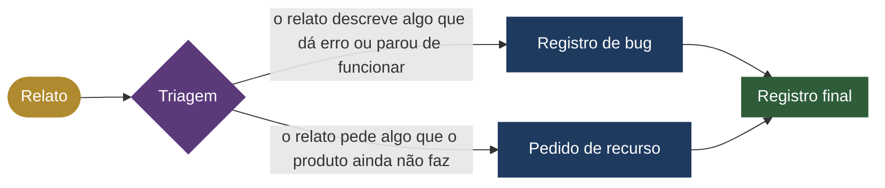
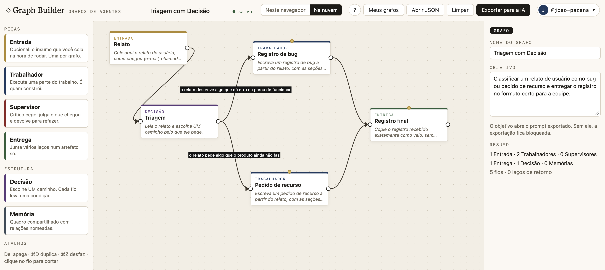

# Tutorial 02 — Triagem com Decisão

## 1. Objetivo

Montar um grafo que **escolhe um caminho**: um relato de usuário chega, uma **Decisão** diz se ele
é um bug ou um pedido de recurso, e só o Trabalhador daquele caminho escreve o registro.

Ao terminar, você terá visto:

- a peça **Decisão** e os fios de **condição** (`Condition`), um por caminho;
- o painel **"Antes de exportar"** acusando **VAL-03** (fio sem condição) e **VAL-04** (menos de
  dois caminhos) enquanto o grafo é montado;
- uma **Entrega que junta dois caminhos**, dos quais só um roda;
- o que acontece com um relato **ambíguo**, que cabe nas duas condições.

Não há Supervisor aqui: o foco é a Decisão. A barra volta no tutorial 03.

### Onde rodar

Como no [tutorial 01](01-primeiro-laco.md#onde-rodar): o Graph Builder na web, em
<https://joao-parana.github.io/graph-builder/>, no modo **Neste navegador** ou **Na nuvem**.

#### Atalho importando um Grafo já existente

Baixe [`exemplos/02-triagem-com-decisao.json`](exemplos/02-triagem-com-decisao.json), carregue-o
com **Abrir JSON** e pule para a [seção 5](#5-o-prompt-exportado).

## 2. O grafo





A Decisão **não constrói**: não tem artefato próprio nem ponto dourado. Ela só escolhe por qual
fio o relato segue. Cada fio que sai dela é um **caminho** e leva uma **condição escrita**, que é
texto para a IA ler, não código.

A Entrega recebe dos dois Trabalhadores, mas em cada execução só um deles roda. O outro fica
**fora do caminho**.

## 3. Passo a passo no editor

Em cada passo, olhe o painel **"Antes de exportar"**. Os **erros** bloqueiam a exportação; os
**alertas** não. O painel mostra os 5 primeiros e, se houver mais, "+ N outros".

**Passo 1 — Grafo novo.** Em **Meus grafos**, clique em **+ Novo grafo** e troque o título para
`Triagem com Decisão`.

> Antes de exportar: **2 erros**
> - O grafo está sem objetivo — escreva, na direita, o que ele precisa entregar. *(VAL-01)*
> - O grafo não tem nenhuma Entrega. *(VAL-07)*

**Passo 2 — Objetivo.** Clique numa área vazia do canvas e, em **Objetivo**, escreva:

```text
Classificar um relato de usuário como bug ou pedido de recurso e entregar o registro no formato certo para a equipe.
```

Some o VAL-01. Fica o VAL-07. Este grafo não tem parâmetros: nada muda de uma execução para outra.

**Passo 3 — Entrada e Decisão.** Na paleta, ponha uma **Entrada** e uma **Decisão** e ligue a
Entrada à Decisão.

> Antes de exportar: **1 erro** e **3 alertas**
> - O grafo não tem nenhuma Entrega. *(VAL-07)*
> - "Entrada 1" está sem instruções. *(VAL-02)*
> - "Decisão 1" está sem instruções. *(VAL-02)*
> - "Decisão 1" tem menos de dois caminhos. *(VAL-04)*

O VAL-04 já aparece com **zero** caminhos: uma Decisão precisa de pelo menos dois para ter o que
escolher. O inspetor da Decisão diz o mesmo em **Caminhos (escolhe UM)**: "Ligue a Decisão a duas
ou mais peças para criar os caminhos."

**Passo 4 — Primeiro caminho.** Ponha um **Trabalhador** e ligue a Decisão a ele. O app faz desse
fio um caminho (`Condition`) porque ele sai de uma Decisão, e o painel ganha um **erro**:

> Antes de exportar: **2 erros** e **4 alertas** (5 visíveis e "+ 1 outro")
> - "Decisão 1" tem um fio sem condição escrita. *(VAL-03)*
> - O grafo não tem nenhuma Entrega. *(VAL-07)*
> - VAL-02 para "Entrada 1", "Decisão 1" e "Trabalhador 1".
> - "Decisão 1" tem menos de dois caminhos. *(VAL-04)*

**Passo 5 — Condição.** Clique na Decisão. Em **Caminhos (escolhe UM)**, o caminho para
"Trabalhador 1" mostra "Este fio precisa de uma condição escrita." Escreva:

```text
o relato descreve algo que dá erro ou parou de funcionar
```

Some o VAL-03. O VAL-04 continua: ainda é um caminho só.

**Passo 6 — Segundo caminho.** Ponha outro **Trabalhador**, ligue a Decisão a ele e escreva a
condição:

```text
o relato pede algo que o produto ainda não faz
```

Ao ligar, **some o VAL-04** (já são dois caminhos) e volta o VAL-03 (o fio novo ainda está sem
condição). Ao escrever a condição, some o VAL-03 de novo.

> **Condições excludentes.** A Decisão escolhe **um** caminho. Escreva as condições de modo que
> um relato típico caiba em só uma delas. A seção 6 mostra o que acontece quando um relato cabe
> nas duas.

**Passo 7 — Entrega.** Ponha uma **Entrega** e ligue **os dois** Trabalhadores a ela. Some o
VAL-07: **não há mais erros**, só os cinco alertas de instruções vazias.

**Passo 8 — Nomes e instruções.** Preencha **Nome da peça** e **Instruções**:

- **Entrada** → `Relato`
  ```text
  Cole aqui o relato do usuário, como chegou (e-mail, chamado ou mensagem).
  ```
- **Decisão** → `Triagem`
  ```text
  Leia o relato e escolha UM caminho pelo que ele pede.
  ```
- **Trabalhador** do caminho do erro → `Registro de bug`
  ```text
  Escreva um registro de bug a partir do relato, com as seções: Título, Passos para reproduzir, Resultado esperado, Resultado obtido.
  Comece com "Tipo: bug". Se o relato não disser algo, escreva "não informado"; não invente.
  ```
- **Trabalhador** do caminho novo → `Pedido de recurso`
  ```text
  Escreva um pedido de recurso a partir do relato, com as seções: Título, Quem pede, Problema, Proposta.
  Comece com "Tipo: pedido de recurso". Se o relato não disser algo, escreva "não informado"; não invente.
  ```
- **Entrega** → `Registro final`
  ```text
  Copie o registro recebido exatamente como veio, sem acrescentar título, cabeçalho nem comentários.
  ```

O painel "Antes de exportar" fica vazio.

**Passo 9 — Exportar.** **Exportar para a IA** → aba **Prompt (.md)** (seção 5) e aba **JSON**.

## 4. As peças

| Peça | Tipo | Instruções | Recebe de | Envia para |
|---|---|---|---|---|
| Relato | Entrada | Cole aqui o relato do usuário, como chegou (e-mail, chamado ou mensagem). | — | Triagem |
| Triagem | Decisão | Leia o relato e escolha UM caminho pelo que ele pede. | Relato | Registro de bug · Pedido de recurso |
| Registro de bug | Trabalhador | Escreva um registro de bug a partir do relato, com as seções: Título, Passos para reproduzir, Resultado esperado, Resultado obtido. Comece com "Tipo: bug". Se o relato não disser algo, escreva "não informado"; não invente. | Triagem | Registro final |
| Pedido de recurso | Trabalhador | Escreva um pedido de recurso a partir do relato, com as seções: Título, Quem pede, Problema, Proposta. Comece com "Tipo: pedido de recurso". Se o relato não disser algo, escreva "não informado"; não invente. | Triagem | Registro final |
| Registro final | Entrega | Copie o registro recebido exatamente como veio, sem acrescentar título, cabeçalho nem comentários. | Registro de bug · Pedido de recurso | — |

| Caminho (fio da Triagem) | Condição |
|---|---|
| → Registro de bug | o relato descreve algo que dá erro ou parou de funcionar |
| → Pedido de recurso | o relato pede algo que o produto ainda não faz |

### Por que as Instruções são assim

- **"não informado; não invente".** Sem Supervisor, ninguém confere o registro. A instrução reduz
  o risco de o Trabalhador inventar passos de reprodução ou um nome de quem pede.
- **A Entrega só copia.** Ela recebe um registro pronto. A primeira versão dizia "Entregue o
  registro do caminho escolhido, sem comentários", e em 2 de 3 execuções a Entrega acrescentou a
  linha `Registro final — caminho escolhido: Pedido de recurso`. "Sem comentários" não bastou;
  "copie exatamente, sem título nem cabeçalho" bastou (seção 6).

## 5. O prompt exportado

Este é o texto exato da aba **Prompt (.md)** (o `graphId` do rodapé muda a cada grafo):

````markdown
# Grafo: Triagem com Decisão

## Objetivo
Classificar um relato de usuário como bug ou pedido de recurso e entregar o registro no formato certo para a equipe.

## Como executar
Execute as etapas na ordem abaixo. Cada Trabalhador produz um artefato.

## Entrada
Cole aqui o relato do usuário, como chegou (e-mail, chamado ou mensagem). → alimenta: Triagem

## Etapas
### 1. Triagem (Decisão — escolha UM caminho)
Instruções: Leia o relato e escolha UM caminho pelo que ele pede.
Recebe de: Relato
- Se "o relato pede algo que o produto ainda não faz" → Pedido de recurso
- Se "o relato descreve algo que dá erro ou parou de funcionar" → Registro de bug

### 2. Pedido de recurso (Trabalhador)
Instruções:
Escreva um pedido de recurso a partir do relato, com as seções: Título, Quem pede, Problema, Proposta.
Comece com "Tipo: pedido de recurso". Se o relato não disser algo, escreva "não informado"; não invente.
Recebe de: Triagem · Envia para: Registro final

### 3. Registro de bug (Trabalhador)
Instruções:
Escreva um registro de bug a partir do relato, com as seções: Título, Passos para reproduzir, Resultado esperado, Resultado obtido.
Comece com "Tipo: bug". Se o relato não disser algo, escreva "não informado"; não invente.
Recebe de: Triagem · Envia para: Registro final

### 4. Registro final (Entrega)
Instruções: Copie o registro recebido exatamente como veio, sem acrescentar título, cabeçalho nem comentários.
Junte: Pedido de recurso, Registro de bug → artefato final.

## Saída esperada
O artefato de "Registro final".

<!-- graph-builder schemaVersion=1 graphId=c17c2bb5-efdb-4a96-8f10-4c59b906059d -->
````

Repare no que o app escreveu sem você digitar:

- "(Decisão — escolha UM caminho)" no título da etapa e uma linha `- Se "…" → …` por caminho;
- "Junte: Pedido de recurso, Registro de bug": a Entrega lista os dois, mesmo que só um vá chegar;
- "Como executar" tem uma frase só: sem Supervisor, o prompt não fala de crítico cego.

## 6. O que observar ao rodar no Claude

Três relatos de teste, fictícios:

| Relato | Caminho esperado |
|---|---|
| [`exemplos/02-relato-bug.md`](exemplos/02-relato-bug.md): o botão "Exportar" some ao trocar de aba desde a última atualização | Registro de bug |
| [`exemplos/02-relato-recurso.md`](exemplos/02-relato-recurso.md): pede exportar direto em PDF, com o logotipo | Pedido de recurso |
| [`exemplos/02-relato-ambiguo.md`](exemplos/02-relato-ambiguo.md): não acha a opção de PDF, mas um colega "jura que já exportou" | qualquer um, com o motivo no log |

### Com a skill `/executar-grafo` no Claude Code (RECOMENDADO)

Prepare a pasta de trabalho como no [tutorial 01](01-primeiro-laco.md#com-a-skill-executar-grafo-no-claude-code-recomendado):
a skill em `.claude/skills/executar-grafo/SKILL.md`, o prompt baixado como
`triagem-com-decisao.md` e os três relatos em `exemplos/`. Rode uma execução por relato:

```text
/executar-grafo triagem-com-decisao.md exemplos/02-relato-bug.md
/executar-grafo triagem-com-decisao.md exemplos/02-relato-recurso.md
/executar-grafo triagem-com-decisao.md exemplos/02-relato-ambiguo.md
```

Na skill, a **Decisão roda no orquestrador**, não num subagente: não existe "Decisão cega". O
orquestrador olha só o que chega à Triagem (o relato), escolhe um caminho e escreve o porquê no
log. Os Trabalhadores e a Entrega rodam cada um num subagente novo, como no tutorial 01.

Foi isto que aconteceu quando o autor rodou as três:

| Relato | Caminho escolhido | Fora do caminho | Por quê (resumo do log) |
|---|---|---|---|
| bug | Registro de bug | Pedido de recurso | "Antes da atualização funcionava normal": algo parou de funcionar |
| recurso | Pedido de recurso | Registro de bug | Descreve um contorno manual e pede uma função nova; nada dá erro |
| ambíguo | Pedido de recurso | Registro de bug | A opção não aparece em nenhum menu e não há erro relatado; o "colega jura" é de terceiro |

Observe no `rodadas.md`:

- **O caminho e o porquê.** A seção da Triagem diz qual condição foi escolhida e por quê, e
  termina com `Fora do caminho: {peça}`. A peça fora do caminho aparece no log como "não rodou".
- **A Entrega que junta dois caminhos.** O pacote enviado à Entrega tem só `Junte: {peça que
  chegou}` e o artefato dela. O caminho descartado não entra, nem como aviso. A auditoria da
  Entrega registra `Junte: {peça} fora (Decisão Triagem)`.
- **"não informado" em vez de inventar.** No relato de bug, o Trabalhador marcou como "não
  informado" a versão do Chrome e o sistema operacional. No ambíguo, o formato e o local da
  opção de PDF. Ele também acrescentou uma seção "Informações adicionais" que as Instruções não
  pediam: sem Supervisor, nada barra isso.
- **O relato ambíguo.** Não há resposta certa. O que se avalia é a Decisão escolher **um** caminho
  e registrar o motivo. O log do autor anota a fraqueza das condições: nenhuma cobre "a opção não
  aparece para mim, mas talvez exista". O Pedido de recurso que saiu traz essa dúvida no próprio
  texto ("Se ela já existe, verificar por que não aparece na conta da Rita").
- **A Entrega obedeceu?** Com a primeira versão das Instruções ("Entregue o registro do caminho
  escolhido, sem comentários"), a Entrega das execuções recurso e ambíguo pôs antes do registro a
  linha `Registro final — caminho escolhido: Pedido de recurso`. Com a versão atual ("Copie o
  registro recebido exatamente como veio, sem acrescentar título, cabeçalho nem comentários"), as
  duas reexecuções devolveram o registro idêntico ao recebido. Ninguém reprovou a primeira versão:
  foi preciso ler o artefato final para ver. É o argumento para pôr um Supervisor (Variação 3).

### À mão, no Claude Desktop (NÃO RECOMENDADO)

1. Numa conversa, cole o prompt e, depois dele, um relato. Peça para dizer qual caminho a Triagem
   escolhe e por quê, e para parar ali.
2. Peça o registro do caminho escolhido e, depois, o Registro final.
3. Confira se o Registro final é o registro sem nada a mais. Repita numa conversa nova com cada
   relato.

Aqui o Trabalhador vê o prompt inteiro, inclusive as Instruções do outro caminho. Isso não fere
nenhuma regra (não há crítico a cegar), mas é menos isolado que a skill.

## Variações

1. **Três caminhos.** Acrescente um caminho "o relato é uma dúvida de uso" → Trabalhador
   `Resposta ao usuário`, ligado à Entrega. Rode o relato ambíguo de novo: ele muda de caminho?
2. **Condições que se sobrepõem.** Troque a condição do bug por "o relato fala de exportação".
   Os três relatos cabem nela. O que a Triagem escolhe, e o que o log diz?
3. **Um Revisor antes da Entrega.** Ponha um Supervisor entre cada Trabalhador e a Entrega com a
   barra `Reprove se o artefato não começar com "Tipo:"` e `Reprove se alguma seção estiver
   vazia.` A primeira linha vira gate (conferida por script); a segunda vai ao crítico.
4. **Um caminho só.** Apague o fio da Triagem para o Pedido de recurso: volta o VAL-04 (alerta,
   não erro). Exporte mesmo assim e veja a etapa da Decisão no prompt.
